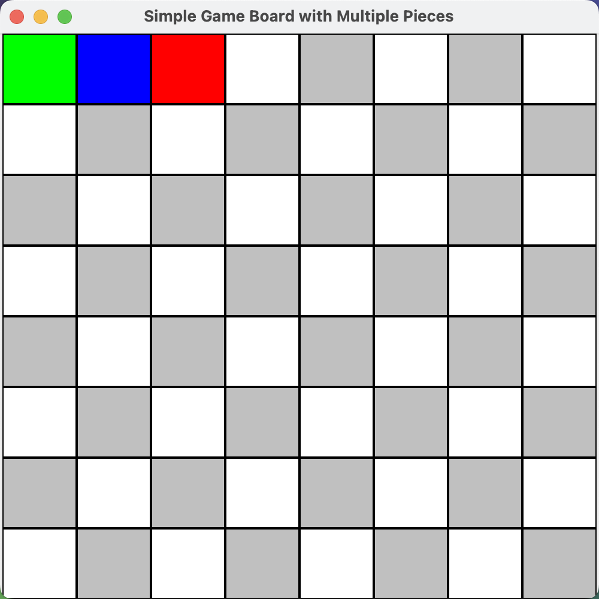

# README Example

Use this structure for your chess project's README, replacing the example content with your own. Include the phase and branch/folder being submitted. Follow the project instructions and rubric for any separate documents you must submit.

The example below describes the course's **SimpleGameBoard** demo, not a complete chess game.

## Project overview

SimpleGameBoard is a Java Swing demo with an 8x8 board and three colored markers. Users move a marker by clicking it and then clicking an empty square.

## Requirements and run instructions

- JDK 8 or newer. No external libraries are needed.
- A computer with a graphical desktop.

Open the course repository's root folder, which contains `ProjectMaterial/`. Create an `out` folder if it does not already exist, then run:

```bash
javac -encoding UTF-8 -d out ProjectMaterial/Phase2/SimpleGameBoard.java
java -cp out ProjectMaterial.Phase2.SimpleGameBoard
```

A window titled **Simple Game Board with Multiple Pieces** should appear. For your own project, provide your actual build/run commands and working directory.

## How to use

1. Click a green, blue, or red marker to select it. Its border turns yellow.
2. Click an empty square to move the marker there.
3. Close the window to exit.

## Features and limitations

- Implemented: 8x8 board, three colored markers, click-to-move, and selection highlighting.
- Not implemented: actual chess pieces, captures, turn-taking, chess movement rules, check, or checkmate.
- Limitation: clicking an occupied square does not move the selected marker or change the selection.

For your chess project, summarize the features you actually implemented, explain how to try any extra features, and identify incomplete features or known issues.

## Preview



For your project, include an actual screenshot or working preview/demo link. Check that the link opens from GitHub.
